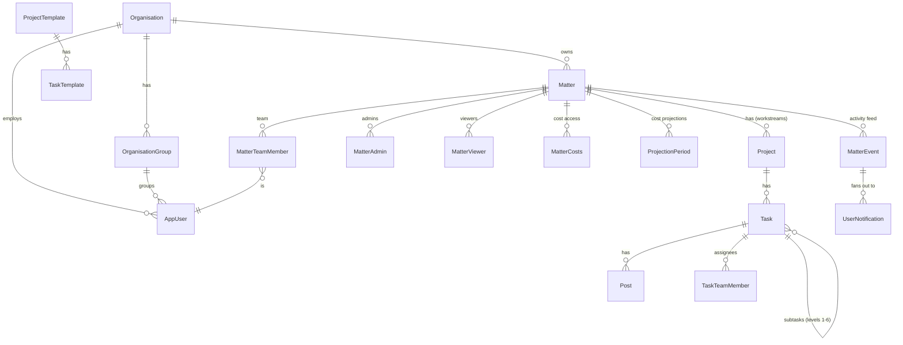

# Juralio Data Model

This document describes the persistent tables (GORM domain classes) that make up the
Juralio backend, what each one represents, how it is used, and how they relate to one
another.

Domain classes live under `server/grails-app/domain/com/juralio/`. Each class maps to one
database table; associations (`belongsTo`, `hasMany`, and typed properties) map to foreign
keys or join tables. Properties listed in a class's `static transients` block are **not**
columns — they are runtime-only fields (counts, flags, DTOs) hydrated by services — so they
are called out separately below and excluded from the "columns" descriptions.

> **Auditing.** Any class that `implements Auditable` has its create/update/delete changes
> recorded in the `audit_log` table (see [`AuditTrail`](#audittrail)) via the
> grails-audit-logging plugin.

### Physical schema notes

- **Database:** PostgreSQL (`org.hibernate.dialect.PostgreSQLDialect`).
- **Schema management:** the schema is **not** generated from the domain classes in
  production — `dbCreate` is `none` and the schema is driven by **Liquibase migrations** in
  `server/grails-app/migrations/`. (The test datasource uses `dbCreate: update`.) So the
  authoritative column list is domain class + migrations, not either alone.
- **Table/column naming:** GORM maps `CamelCase` class names to `snake_case` tables and
  properties — e.g. `MatterTeamMember` → `matter_team_member`, `userDefinedReferenceNumber`
  → `user_defined_reference_number`. The only explicit override is `AuditTrail` → `audit_log`.
- **Implicit join tables:** `hasMany` collections that aren't their own domain class get an
  auto-generated join/child table — e.g. `Task.tasks` (subtasks) uses a `task_task` self-join,
  and template collections use `task_template_task_template` / `task_template_post`.
- **Legacy / not covered here:** a handful of physical tables are historical or externally
  managed and are *not* documented as current domains — see
  [Legacy & non-GORM tables](#legacy--non-gorm-tables).

---

## Contents

1. [The core hierarchy](#1-the-core-hierarchy)
2. [Users, roles & authentication](#2-users-roles--authentication)
3. [Organisations & groups](#3-organisations--groups)
4. [Matter membership & parties](#4-matter-membership--parties)
5. [Projects (workstreams) & tasks](#5-projects-workstreams--tasks)
6. [Posts & noticeboard](#6-posts--noticeboard)
7. [Labels](#7-labels)
8. [Costs & pricing](#8-costs--pricing)
9. [Templates](#9-templates)
10. [Events & notifications](#10-events--notifications)
11. [Recency & "seen" tracking](#11-recency--seen-tracking)
12. [Link resources](#12-link-resources)
13. [Instance, admin & housekeeping](#13-instance-admin--housekeeping)
14. [Legacy & non-GORM tables](#legacy--non-gorm-tables)

---

## High-level relationship map

---

## 1. The core hierarchy

Juralio is a matter-management platform. The central spine of the data model is:

**Organisation → Matter → Project (workstream) → Task (levels 1–6) → Post**

- An **Organisation** is a tenant (a law firm, legal team, or company).
- A **Matter** is a piece of legal work owned by an organisation.
- A **Project** (called a *workstream* in the UI) is a stream of work within a matter.
- A **Task** is a unit of work within a project; tasks nest up to 6 levels deep.
- A **Post** is a note / document / link / event attached to a task.

Everything else hangs off this spine: membership, costs, labels, templates, notifications
and tracking tables.

---

## 2. Users, roles & authentication

### AppUser
`auth/AppUser.groovy` — **the user account table.**

The person who logs in. Holds credentials (`username` (email), `password`, MFA fields
`mfaEnabled`/`mfaRegistered`/`mfaKey`), account state (`enabled`, `accountLocked`,
`accountExpired`, `passwordExpired`, `failedLoginAttempts`), trial/confirmation lifecycle
(`confirmationStatus` — one of `trialing`/`confirmed`/`lapsed`/`whitelisted`,
`trialStartDate`), third-party/SSO identity (`thirdPartyUserId`, `thirdPartyProvider`,
`isThirdPartyUser`), and avatar indices.

- **Belongs to** one `Organisation` (nullable) and optionally one `OrganisationGroup`.
- Has an embedded `FirstTimeUserExperience` and an `externalUser` reference.
- Roles are **not** stored directly on the user — they come through `UserRole` (see below).
  `getAuthorities()`/`hydrateRoles()` resolve them at runtime.
- Note: once set, a user's organisation cannot be changed (enforced in `beforeUpdate` —
  throws `UserAlreadyHasOrganisationException`).
- Many transient fields (`roles`, `isActiveOnMatter`, `isPlaceholder`, `sessionTimeout`, …)
  are computed per request and not persisted.

> **`confirmationStatus` in the frontend.** `CONFIMRATION_STATUS` in `constants.js` (note the
> misspelling) = `trialing` / `whitelisted` / `confirmed` / `lapsed`. `confirmed` is the normal
> "paying seat" state; `trialing` is a user still in trial; `lapsed` is blocked at login
> (`LOGIN_FAILURE_REASONS.USER_LAPSED`) and can be re-activated to `confirmed`; `whitelisted`
> bypasses confirmation gating. The manage-users table sorts, colours and gates enable/disable
> actions on this value (`components/layouts/manage-users/`).

### Role
`auth/Role.groovy` — **the set of grantable authorities.**

One row per authority string. Cached. The canonical list lives in the `Roles` enum
(`src/main/groovy/com/juralio/auth/Roles.groovy`):

`ROLE_SYSADMIN`, `ROLE_USER`, `ROLE_DEMO`, `ROLE_MATTER_CREATOR`, `ROLE_NEUTRAL_MATTER_CREATOR`,
`ROLE_ORG_ADMIN`, `ROLE_ORG_OWNER`, `ROLE_KNOWLEDGE_MANAGER`, `SYSTEM_TEMPLATE_MANAGER`,
`ROLE_TEMPLATE_PROVIDER`, `ROLE_UPDATES`, `ROLE_WIP`, `ROLE_ANALYSIS`.

Two entries are **not** real DB roles: `ROLE_MATTER_ADMIN` (a frontend-only concept derived
from matter membership) and `FROZEN_ORG_USER` (injected at runtime by `hydrateRoles()` to put
users in read-only mode when their org is frozen).

### UserRole
`auth/UserRole.groovy` — **join table between `AppUser` and `Role`** (many-to-many).

Composite primary key of `(user, role)`. This is how a user is granted one or more roles.
`ROLE_MATTER_ADMIN` is *not* here — it is a frontend-only concept derived from matter
membership.

### ExternalUser
`auth/ExternalUser.groovy` — marker/placeholder domain (currently empty) referenced by
`AppUser.externalUser`; reserved for external-user support.

### UserAuthToken
`auth/UserAuthToken.groovy` — **persistent "remember me" / API auth tokens.**

`tokenValue` + `username`, with an `accessCount` incremented on load. On a hosted instance
(`DOMAIN` env set), inserting a new token for a username deletes that user's existing tokens
(single active token per user).

### UserSessionEvent
`auth/UserSessionEvent.groovy` — **login/logout session audit.**

Records `user`, `eventType`, `time`, and `requestIssuerIpAddress`. Used for session/security
history.

### UserStatusEvent
`auth/UserStatusEvent.groovy` — **user account status-change audit.**

Records `user`, who it was `performedBy`, `eventType`, and `time` (e.g. enabled, disabled,
confirmed).

### SamlSettings
`auth/SamlSettings.groovy` — **SAML SSO configuration** (identity-provider entity id, SSO
URL, certificate, and service-provider metadata). Instance-level SSO wiring.

---

## 3. Organisations & groups

### Organisation
`organisation/Organisation.groovy` — **the tenant.**

Owns users, matters, labels and groups. Carries feature/security flags
(`mfaEnabled`, `costsEnabled`, per-provider SSO flags, `googleDriveEnabled`), branding
(`logo`/`logoMimeType`), billing state (`hasConfiguredBilling`), lifecycle
(`enabled`, `isFrozen` + `frozenDate`, set automatically on freeze), and cost-flow
onboarding flags. `confirmedUserCount` tracks paid seats.

- **Has many** `users` (`AppUser`), `labels`, `inactiveLabels`.
- Referenced by nearly everything tenant-scoped (matters, groups, costs config, templates).

### OrganisationGroup
`organisationgroup/OrganisationGroup.groovy` — **a sub-grouping of users within an org.**

E.g. a department or an "internal" group. Belongs to an `Organisation`, has a `name`,
an `isInternal` flag, an optional `groupPosition`, and its own logo. `AppUser.organisationGroup`
points here.

### GroupPosition
`organisationgroup/GroupPosition.groovy` — **the "position" a group plays** (e.g. *Client*
vs *Advisor*).

Belongs to an `Organisation` and optionally a `Matter`. Positions drive the costs model and
matter-level access rules (Client vs Advisor views). Org-level positions have a null matter;
matter-scoped positions reference a matter.

> **Position in the frontend.** `POSITIONS` in `constants.js` pins the two positions to fixed
> ids — `Client` = `{ value: 0, id: 17 }`, `Advisor` = `{ value: 1, id: 18 }` — and comparisons
> are done on `.name`. Client vs Advisor is a **major view switch**: it changes rate-card
> labels (e.g. the base rate is called *Target* on the Client side, *Standard* on the Advisor
> side — see [`RateType`](#ratetype)), which cost dashboards render, and the matter
> people/creation flows. New devs setting up costs E2E fixtures must create matters with the
> right position (Client vs Advisor): matters default to `Client`, and the costs endpoints are
> position-scoped, so advisor-side specs must create an Advisor-positioned matter explicitly
> (the `createMatter` helper takes a position argument) or the costs screens will not render
> as the spec expects.

### MatterGroupPosition
`organisationgroup/MatterGroupPosition.groovy` — **join** linking a `Matter`, a
`GroupPosition`, and an `OrganisationGroup`.

Records which group holds which position on a given matter (i.e. "this group is the Client on
this matter").

---

## 4. Matter membership & parties

### Matter
`matter/Matter.groovy` — **a piece of legal work.**

Core columns: `name`, `clientName`, `department`, `caseId`, `userDefinedReferenceNumber`,
`description`, `matterStatus` (defaults to `inactive`), `creationDate`, `isNeutralMatter`,
`isPersonal`.

`matterStatus` values come from the `MatterStatus` enum: `active`, `inactive`, `closed`,
`pending deletion`.

- **Belongs to** an `Organisation`; has a `creator` (`AppUser`).
- **Has many** `projects`, `matterAdmins`, `teamMembers`, `matterViewers`, `matterCosts`,
  `labels`, `inactiveLabels`.
- `deletedMirror` points to a soft-deleted copy (used by the delete/restore flow).
- `groupPositions`/`positionsOfGroups` are transient (populated from `MatterGroupPosition`).

### MatterAdmin
`matter/MatterAdmin.groovy` — **join: which users administer a matter.**
`(matter, user)` with `user` unique per matter. Matter admins can manage the matter's team,
settings and workstreams.

### MatterTeamMember
`matter/MatterTeamMember.groovy` — **join: the matter's working team.**
`(matter, user, dateCreated)`, `user` unique per matter. These are the people who can be
assigned to tasks within the matter.

### MatterViewer
`matter/MatterViewer.groovy` — **join: read-only access to a matter.**
`(matter, user)` (plus persisted `dateCreated`/`lastUpdated`), `user` unique per matter.
Viewers see the matter but can't edit.

### Placeholders
`matter/Placeholders.groovy` — **"pending"/unregistered people on a matter.**

A named person (first/last name, email) who can be assigned to tasks and posts *before* they
have an `AppUser` account. Belongs to a `Matter`, optionally an `Organisation`. Referenced by
`TaskTeamMember.placeholder` and `PostMember.placeholder`.

### MatterParty *(effectively dead — see note)*
`matter/MatterParty.groovy` — **a party/side in a matter** (e.g. claimant, defendant).
Has a `name`, a free-text `String` `type`, and belongs to a `Matter`. `members` is transient.

> **⚠️ Effectively dead.** The domain, `MatterPartyController`, `MatterPartyService`, DAO and
> the `views/matterParty/` GSON views all still exist, but **nothing reachable writes this
> table**: its own URL mappings are **commented out** in `UrlMappings.groovy`, and the sole
> live caller (`MatterController.save`) only runs when `isNeutralMatter == true` *and* the
> request body carries `matterParties` — which the **current frontend never sends** (zero
> `matterParty`/`matterParties` references in `frontend/src`; `isNeutralMatter` is the
> experimental dispute-platform flag). The `type` column was intended to distinguish sides
> (with a `'neutral'` party looked up by `MatterPartyService.getNeutralParty`), but in practice
> no rows are created. Treat this as a **dormant / dead feature**: the only other references are
> cleanup in `MatterDeletionService` and an import in `MatterGroupPosition`. Candidate for
> [Legacy & non-GORM tables](#legacy--non-gorm-tables) if it's not being revived.

### MatterPartyMember
`matter/MatterPartyMember.groovy` — **join: users belonging to a `MatterParty`.**
Links a `MatterParty` to an `AppUser`. **Effectively dead** — shares the fate of
[`MatterParty`](#matterparty-effectively-dead--see-note) above (unreachable; never written by
the current frontend).

---

## 5. Projects (workstreams) & tasks

### Project
`project/Project.groovy` — **a workstream within a matter.**

Columns: `name` (unique within matter), `description`, `referenceNumber`, `creationDate`,
`closedDate`, `active`, `isPrivate`, `isPendingDeletion`, `creation_type`
(blank/template/copy). References its `creator`, `closer`, and the `template`/`template_task`
it was built from. `deletedMirror` supports soft-delete/restore.

- **Belongs to** a `Matter`; **has many** `tasks`.
- Many transients: `taskCounts`, `levelATasks`, `postCount`, `peopleCount`,
  `privateWorkstreamTeam`, `height`/`depth`, `mostRecentVisit`.

### Task
`task/Task.groovy` — **a unit of work; the richest domain in the app.**

Hierarchical: a task has a `level` (1–6, "Level A"–"Level F") and **has many** child `tasks`
(subtasks). Limits: max 300 tasks per project, 16 level-A "phases", 8 subtasks per task.

Key columns: `name`, `description`, `status`/`previousStatus` (from the `TaskStatus` enum:
`not-started`, `in-progress`, `done`, `task-not-required`), planned & actual start/end
dates (with validators enforcing sane ordering and no future actuals), `isParked`,
`isMilestone`, `isDeliverable`, `datesLinkedToSiblings`, `referenceNumber`, and archival
fields (`archivedDate`, `archivedBy`, `taskParentWhenArchived`).

- **Belongs to** a `Project`.
- **Has many**: child `tasks`, `posts`, `followers` (`TaskFollower`), `teamMembers`
  (`TaskTeamMember`), `seenBy` (`TaskSeenBy`), `labels` (`TaskLabel`). Note `blockers`
  (`TaskBlocker`) is declared in `hasMany` **but also in `static transients`**, so it is
  hydrated at runtime from `TaskBlocker` rows rather than mapped as a normal persisted
  association.
- Extensive transients for UI: `taskCounts`, `isBlocked`/`isBlocker`, `milestones`,
  `isCurrentUserFollower`, `postCount`, etc.

### TaskTeamMember
`task/team/TaskTeamMember.groovy` — **join: who is assigned to a task.**
Links a `Task` to either an `AppUser` **or** a `Placeholder` (unique per task). Transient
`isOnAllSubtasks`/`isOnSomeSubtasks` describe cascade to subtasks.

### TaskFollower
`task/follower/TaskFollower.groovy` — **join: users following a task** (for notifications).
`(user, task)`, user unique per task.

### TaskSeenBy
`task/seenBy/TaskSeenBy.groovy` — **join: which users have seen a task** (unread/read
indicators). `(user, task)`, user unique per task.

### TaskLabel
`task/label/TaskLabel.groovy` — **join: labels applied to a task.**
Links a `Label` to a `Task`, with an optional `modifier` (only valid for `risk`-type labels).

> **`modifier` in the frontend.** `modifier` is a **RAG level** — `LABEL_MODIFIERS` in
> `constants.js` = `'red'` / `'amber'` / `'green'`. It is only meaningful for `risk`-type
> labels, where it colours the risk chip; `workflow` and `user_defined` labels ignore
> `modifier` and use their own configured colour instead.

### TaskBlocker
`task/TaskBlocker.groovy` — **task dependency / blocking relationship.**
`blocker` task blocks `blocked` task, with a `relationship` type code. Models the
dependency graph between tasks.

> **`relationship` in the frontend.** `relationship` is a `Long` that **currently only ever
> holds `0`** (it defaults to `0` and `TaskBlockerDAOService.createTaskBlocker` never sets
> anything else) — it is a **reserved field** for future dependency kinds (e.g.
> finish-to-start vs start-to-start). Direction is *not* stored in this field: it comes from
> **which task sits in `blocker` vs `blocked`**. The frontend never reads `relationship`; it
> derives direction from the pair and sends `{ blocks: true }` (via `addBlocker`) or
> `{ blockedBy: true }` (via `addBlocked`) in `services/task/task-blocker-service.js`, and
> splits a task's `blockers` into "blocks" vs "blocked-by" lists by comparing
> `item.blocker.id` to the current task id (`TaskLinksContainer.js`). Error code
> `TASK_BLOCKED_BY_IN_PROGRESS` (335) is raised when a blocked task is progressed too early.

### TaskCreationContext
`task/TaskCreationContext.groovy` — **provenance of a task.**
Records how a `Task` was created (`creation_type` = blank/template/copy), by which `creator`,
and from which `template`/`template_task`/`task_copy`.

### CreationType (`Creation_type`)
`task/CreationType.groovy` — enum (`FROM_BLANK`, `FROM_TEMPLATE`, `FROM_COPY`) used by
`creation_type` fields. Not a table.

### PrivateWorkstreamMember
`task/recency/PrivateWorkstreamMember.groovy` (package `server`) — **join: members of a
private workstream.**
Links an `AppUser` to a `Project` (`workstream`). Used when a project `isPrivate` to gate
access. Transient fields link back to the matter membership rows.

---

## 6. Posts & noticeboard

### Post
`post/Post.groovy` — **a note, document, weblink, or event on a task.**

Columns: `name`, `type`, `url`, `description` (large text), `dateCreated`, `referenceNumber`,
`startTime`/`endTime` (for event-type posts), `privatePost`, `finalised`/`finalisedBy`, and
archival snapshot fields (`archivedDate`, `archivedBy`, `matterWhenArchived`,
`projectWhenArchived`, `taskWhenArchivedId` — stored as a raw id to avoid eager init).

- Attached to a `Task` (via the task's `posts` collection; `task` is transient on Post).
- **Has many** `authors` (`PostAuthor`) and `members` (`PostMember`), both cascade-deleted.

> **`type` in the frontend.** `type` is stored as a **human-readable label, not a short
> code** — the canonical set is `NOTE_TYPES` in `frontend/src/app/constants.js`. A `null`/empty
> `type` or `'Post'` is a plain rich-text note; `'Meeting'` is a meeting/event note (uses
> `startTime`/`endTime` and shows "meeting held" once finalised); `'Document link'` / `'Web
> Link'` are generic URL links; and the rest (`'Google Doc'`, `'Microsoft Word Document'`,
> `'Miro Board'`, `'Figma File'`, `'Atlassian'`, …) are typed external links. The `type` drives
> **which icon** renders (`services/helpers/post/post-icon-helper.js` +
> `post-link-type-list.js`) and **which editor** the create/edit flow shows (URL field vs
> rich-text — `components/flows/create-note-flow/`). Typed link values are auto-detected from
> the pasted URL using the `GOOGLE_URLS` / `MICROSOFT_URL` / `MIRO_URL` / `ATLASSIAN_URL` /
> `FIGMA_URL` matchers in `constants.js`.

### PostAuthor
`post/authors/PostAuthor.groovy` — **join: authors of a post.** `(user, post)`, user unique
per post.

### PostMember
`post/members/PostMember.groovy` — **join: people associated with a post.**
Links a `Post` to an `AppUser` **or** a `Placeholder`.

### Notice
`noticeboard/Notice.groovy` — **system/marketing notices** shown in-app.
Has an image, `title`/`subtitle`, a live window (`liveStart`/`liveEnd`), display `weight`,
`featured` flag, and inline `svgBytes`. Instance-wide, not matter-scoped.

---

## 7. Labels

Labels tag matters and tasks. The scoping rule (documented in `Label.groovy`):

- no org and no matter → **system-wide** label
- org only → **org-level** label
- org + matter → **matter-level** label

### Label
`label/Label.groovy` — **a tag.** Has `name`, `type` (from `LabelTypes`: `risk`, `workflow`,
`user_defined`), `creator`, and optional `matter`/`organisation` scoping. Applied to tasks
through `TaskLabel`. Transients: `usageCount`, `inactive`, `inactiveBy`, `inactiveSince`.

> **`type` in the frontend.** `LABEL_TYPES` in `constants.js` (`'risk'` / `'workflow'` /
> `'user_defined'`) drives the tabs in the labels admin panel
> (`matter-details/labels/LabelsMatterAdminPanel.js` — one tab per type). Only `risk` labels
> carry a RAG `modifier` on the `TaskLabel` join (see [`TaskLabel`](#tasklabel)).

### InactiveLabel
`label/InactiveLabel.groovy` — **records a label being deactivated** in an org/matter scope.
Points at a `Label` plus the `organisation`/`matter` where it was retired, so a label can be
hidden in one scope without deletion.

---

## 8. Costs & pricing

The costs module models rate cards, time estimates and cost projections for a matter. It is
gated by `Organisation.costsEnabled` and is heavily position-aware (Client vs Advisor — see
[`GroupPosition`](#groupposition)). Most rate-card config domains — `GradeCategory`, `Grade`,
`RateType`, `RateTableDetails`, `OtherCost` — carry an optional `groupPosition` (`Period` and
`Rate` do **not**).

### MatterCosts
`matter/costs/MatterCosts.groovy` — **join: which users have costs access on a matter.**
`(matter, user)`, user unique per matter.

### ProjectionPeriod
`costs/ProjectionPeriod.groovy` — **a costing projection window** (`startDate`/`endDate`) for
a `Matter`. Most cost values below are tied to a projection period, letting a matter hold
multiple projections/scenarios.

### CostSnapshot
`costs/CostSnapshot.groovy` — **a frozen snapshot of a matter's costs** (JSON in `snapshot`,
with `snapshot_date`, `is_retired`, `edit_mode`), scoped to a `ProjectionPeriod` and belonging
to a `Matter`. Backs the "save a version of the costs" flow.

### CostAssumption
`costs/CostAssumption.groovy` — **a stated assumption behind a cost estimate.**
Belongs to a `Matter`, references a `Task` and `AppUser`, with `assumption` text, `summary`,
`position`, and a `status` (from `AssumptionStatus`: `on-target`, `at-risk`, `met`,
`not-met`).

> **`status` and `position` in the frontend.** `status` = `ASSUMPTION_STATUS` in `constants.js`
> and maps to a RAG-style colour via `services/helpers/costs/assumption-status-helper.js`; the
> two "flagged" statuses `at-risk` and `not-met` (`FLAGGED_ASSUMPTION_STATUSES`) raise a
> change-notification flag on the projection. **`position` here is *not* a group position** — it
> is an **integer sort index** for drag-and-drop reordering of the assumptions list
> (`matter-costs/AssumptionsList.js` renumbers then sorts by `position`). (Contrast with the
> costs-wide "position" = Client/Advisor from [`GroupPosition`](#groupposition).)

### GradeCategory
`costs/GradeCategory.groovy` — **a grouping of fee-earner grades** (e.g. "Partners"), with a
`name`, `colour_idx`, owning `Organisation` and optional `groupPosition`.

### Grade
`costs/Grade.groovy` — **a fee-earner grade** (e.g. "Senior Associate").
Belongs to an `Organisation`, optionally a `GradeCategory` and `groupPosition`, ordered by
`grade_idx`. `isBeingUsed` is transient.

### RateType
`costs/RateType.groovy` — **the kind of rate** — flags for standard / break-even / premium /
agreed-client / agreed-matter. `getSysName()` maps these (plus the group position) to display
names like *Target*, *Standard*, *Break-even*, *Premium*, *Agreed - Client/Advisor/Matter*
(the actual strings use a hyphen).

> **In the frontend.** A rate type arrives as an object carrying boolean flags (`isStandard`,
> `isAgreedMatter`, `isAgreedClient`/`isAgreedAdvisor`, …) plus a `sysname`. The display name is
> **position-dependent** (`organisation/users/costs/RateTypeTable.js`): the base rate shows as
> *Target* on the Client side and *Standard* on the Advisor side, and the agreed rate shows as
> *Agreed - Advisor* (Client side) vs *Agreed - Client* (Advisor side), plus *Break-even*,
> *Premium* and *Agreed - Matter*. Rate *tables* have a separate `RATE_TABLE_TYPES` category
> (`organisation` / `client` / `advisor agreed`).

### RateTableDetails
`costs/RateTableDetails.groovy` — **a rate card / rate table.**
Describes a set of rates: `work_type`, `currency`, `location`, `client`/`client_name`,
`draft`, `is_retired`, owning `Organisation`, optional `Matter` and `groupPosition`, and a
self-reference (`rateTableDetails`) for templating. `initalPeriod` is transient.

### Period
`costs/Period.groovy` — **a time band within a rate table** (`name`, `startDate`, `endDate`).
Belongs to an `Organisation`, references a `RateTableDetails` and optional `Matter`. Rates can
change period-to-period.

### Rate
`costs/Rate.groovy` — **the actual monetary rate.**
Joins a `Grade` × `Period` × `RateType` within a `RateTableDetails` to a `rate` value, owned
by an `Organisation`. This is the leaf of the rate-card structure.

### OtherCost
`costs/OtherCost.groovy` — **a named non-time cost line** (e.g. disbursements) defined at
`Organisation`/`groupPosition` level.

### CostRatio
`matter/costs/CostRatio.groovy` — **planned grade mix / recovery for a matter.**
For a `Matter` (and optional `Project`), records a `Grade`'s `ratioValue` and `recoveryRate`
within a `ProjectionPeriod`, optionally tied to a `CostTimeEstimate`.

### CostTimeEstimate
`matter/costs/CostTimeEstimate.groovy` — **estimated hours on a task.**
For a `Task`, an `hourValue` within a `ProjectionPeriod`, optionally linked to a
`MatterPricing`.

### MatterPricing
`matter/costs/MatterPricing.groovy` — **a pricing line for a matter** (a `reason`, a `value`,
a `type`) within a `ProjectionPeriod`.

> **`type` in the frontend.** `type` is an **`Integer` index**, not a string: `0` = time-based
> (rate × hours, optionally capped via `cap`; fees *are* broken down by phase), `1` = fixed fee
> (not broken down by phase), `2` = no fee / non-billable. The costs UI switches on this value
> throughout (`matter-costs/outcomes/revenueHelper.js`, `ProjectionSummary.js`, the
> Revenue/Margin/GrossProfit tables) to pick the calculation and the "no breakdown" messaging;
> the backend uses the same `0/1` split in `CostSnapshotService`.

### OutOfScopeDetails
`matter/costs/OutOfScopeDetails.groovy` — **out-of-scope handling** for a projection —
whether `writtenApprovalNeeded`, a `reason`, tied to a `ProjectionPeriod`.

---

## 9. Templates

Templates let organisations (and the system) predefine reusable project/task structures.

### ProjectTemplate
`template/ProjectTemplate.groovy` — **a reusable workstream blueprint.**
Has `name`, `description`, `referenceNumber`, `published`/`archived` flags,
`isSystemTemplate` (system templates have no organisation; org templates must have one —
enforced in `beforeUpdate`), and cover image fields. (`height`/`depth` are **transient**, not
columns.) **Belongs to** an `Organisation` (nullable for system templates); **has many**
`tasks` (`TaskTemplate`).

### TaskTemplate
`template/TaskTemplate.groovy` — **a task within a project template.**
Mirrors `Task`'s hierarchy: a `level`, **has many** child `tasks` and `posts`, with
`isMilestone`/`isDeliverable` and `noticeboardText`. **Belongs to** a `ProjectTemplate`.

### ProjectTemplateFavourite
`template/ProjectTemplateFavourite.groovy` — **join: a user's favourited templates.**
Links `ProjectTemplate` ↔ `AppUser`.

### ProjectTemplateImageTag
`template/ProjectTemplateImageTag.groovy` — **image/search tags on a template**
(`projectTemplateId` + tag string).

### ProjectTemplateRecency
`template/ProjectTemplateRecency.groovy` — **per-user last-visit time** for a template (see
[Recency](#11-recency--seen-tracking)).

### TemplateProviderSource
`template/TemplateProviderSource.groovy` — **provenance link between templates** — records
that `newTemplate` was derived from `sourceTemplate` (with a `name`). Used when copying/
distributing templates.

### TemplateResource
`templateResource/TemplateResource.groovy` — **a link/resource attached to a template**
(`name`, `url`, `image`), keyed by `templateId`. Template analogue of `LinkResource`.

---

## 10. Events & notifications

The activity/notification system was refactored to an event-sourced shape:
**`MatterEvent` (what happened) → `UserNotification` (per-recipient inbox row).**

### MatterEvent
`matterevent/MatterEvent.groovy` — **an activity event on a matter.**
Records `matter`, `performedBy`, `eventType`, `schemaVersion`, `occurredAt`, a JSON `payload`
(text column), and a `correlationId`. The source of truth for the matter activity feed.

### UserNotification
`usernotification/UserNotification.groovy` — **a per-user inbox entry** for a `MatterEvent`.
`(user, matterEvent)` with matterEvent unique per user, plus `read`/`dismissed` flags. One
`MatterEvent` fans out to many `UserNotification` rows (one per recipient).

### NotificationPreference
`usernotification/NotificationPreference.groovy` — **per-user opt-in/out by event type.**
`(user, eventType)` with `enabled`. Controls which events reach a user.

### NotificationFilterUserRecency
`inboxnotification/NotificationFilterUserRecency.groovy` — **remembers a user's inbox
"filter by person" choice** per project (`user`, `project`, `filterUser`, `dateCreated`).

---

## 11. Recency & "seen" tracking

A family of small tables that record "when did user X last look at Y", powering
recently-visited lists, unread badges and default filters. They share the same shape
(`user`, target, `lastVisit`/`dateCreated`) — **except `Visit`**, which stores only `user` +
`urlPartial` (no target association and no timestamp column).

| Table | File | Tracks |
|-------|------|--------|
| `MatterRecency` | `matter/MatterRecency.groovy` | last time a user visited a **matter** |
| `ProjectRecency` | `project/ProjectRecency.groovy` | last visit to a **project** |
| `ProjectVisitRecency` | `project/ProjectVisitRecency.groovy` | project visit recency (referenced by `Project.mostRecentVisit`) |
| `TaskRecency` | `task/TaskRecency.groovy` | last visit to a **task** (also stores `matter`) |
| `TaskFilterUserRecency` | `task/recency/TaskFilterUserRecency.groovy` | a user's "filter tasks by person" choice on a matter |
| `ProjectTemplateRecency` | `template/ProjectTemplateRecency.groovy` | last visit to a **template** |
| `Visit` | `visit/Visit.groovy` | a coarse per-user `urlPartial` visit record |

See also [`TaskSeenBy`](#taskseenby) (per-task read state) and
[`LinkResourceVisit`](#linkresourcevisit).

---

## 12. Link resources

### LinkResource
`linkresource/LinkResource.groovy` — **an external weblink attached to a matter or
workstream.**
`matterId` (required), optional `workstreamId`, `name`, `url`, `image`, and a `creator`.
Powers the "useful links" panel.

### LinkResourceVisit
`linkresource/LinkResourceVisit.groovy` — **per-user last-visit time for a link resource**
(`user`, `linkResource`, `latestVisitTime`).

---

## 13. Instance, admin & housekeeping

### InstanceSettings
`instance/InstanceSettings.groovy` — **single-row global configuration for the deployment.**
Toggles SSO providers, `enableForgotMyPassword`, `enableUserConfirmation`, `trialPeriod`,
`enableUrlValidation`, `enableAuditLogRotation`, `costsEnabled`, the `initialTemplateId`, and
splash/SSO-emphasis flags. Transient `fullSeats`/`limitedSeats`.

> **Gotcha:** `enableUserConfirmation` is instance-wide, not per-organisation, so a test that
> switches it on leaks into every spec that runs afterwards (a trialing org then appears on the
> home screen, breaking unrelated card-count assertions). If a spec touches it, set it back to
> `false` in an `after` hook, and defensively PATCH it to `false` in `before`.

### EmailWhitelist
`emailwhitelist/EmailWhitelist.groovy` — **allow-listed email addresses** (`whitelisted_email`,
unique) for sign-up/confirmation gating.

### ExperimentalOptions
`experimental/ExperimentalOptions.groovy` — **feature flags** for experimental features
(`dispute_platform`, `internal_external_users`, `roadmap`, `disableTaskLinking`).

### ExperimentalServer
`experimental/ExperimentalServer.groovy` — **a configured experimental server `url`.**

### FirstTimeUserExperience
`ftue/FirstTimeUserExperience.groovy` — **per-user onboarding progress** — a set of
`hasSeenX` booleans (taskmap, templates, timeline, inbox, org admin, home page, …). Owned by
an `AppUser`.

### Tour
`tour/Tour.groovy` — **per-user product-tour completion flags** (statusFilter, templateDraft,
hiddenTask, weblinkCreate, etc.). Owned by an `AppUser`. Complements `FirstTimeUserExperience`.

### DeletedMatterLog
`matter/DeletedMatterLog.groovy` — **audit of deleted matters.**
Snapshots `matterId`, `organisationId`, `matterName`, `matterClient`, `deletedBy`,
`markedForDeletion`, and `permanentlyDeleted` — supports the soft-delete → permanent-delete
cron flow and reporting.

### DeletedOrganisationLog
`organisation/DeletedOrganisationLog.groovy` — **audit of deleted organisations** (same shape
as above, per org).

### MonthlyUsersReportSummary
`server/grails-app/domain/server/MonthlyUsersReportSummary.groovy` — **monthly per-org usage
rollup.** (Unlike every other domain here, this lives in package `server`, a sibling of
`com/juralio/`, not under it.)
(`orgId`, `summaryDate`, `seats`, `confirmedActiveUsers`). Feeds billing/usage reporting.

### AuditTrail
`AuditTrail.groovy` — **the `audit_log` table.**
Written automatically by the grails-audit-logging plugin for every `Auditable` domain change:
`actor`, `uri`, `className`, `persistedObjectId`/`Version`, `eventName`, `propertyName`, and
`oldValue`/`newValue`. Rotation is controlled by `InstanceSettings.enableAuditLogRotation`.

### api_rate_limit *(no domain class)*
`grails-app/migrations/…create_api_rate_limit_table.groovy` — **fixed-window request-rate
counter, keyed by IP.**
Columns: `ip_address`, `window_key` (the time-window bucket), `request_count`, `created_at`,
with a unique index on `(ip_address, window_key)`. There is **no GORM domain class** — it is
read/written directly by `RateLimitService` and enforced in `server/RequestInterceptor`.
(`RateLimitAlertService` handles alerting only — it emails from an in-memory cache and never
touches the table.) Included here because it is a live, first-class table.

---

## Legacy & non-GORM tables

These physical tables show up in the migrations but are **not** current domain classes, so
they're excluded from the sections above. Listed here so the schema isn't mistaken for
incomplete:

| Table(s) | Status |
|----------|--------|
| `inbox_notification`, `user_inbox_notification` | **Dropped.** Superseded by the `matter_event` + `user_notification` event model (see §10). |
| `note`, `task_note` | **Dropped.** Renamed/replaced by `post` (the old "note" concept). |
| `marketplace_project_favourite` | **Dropped.** Template marketplace was removed for open-sourcing; favourites now live in `project_template_favourite`. |
| `acl_class`, `acl_entry`, `acl_object_identity`, `acl_sid` | **Inactive.** Created by an old migration for `spring-security-acl`, but the plugin is commented out in `build.gradle` — the app does not use ACLs (access control is via `@Secured` + membership tables). |
| `audit_log` | Managed by the audit-logging plugin (see [`AuditTrail`](#audittrail)), not hand-written. |
| `api_rate_limit` | Live, but has no domain class — see above. |

---

## Appendix: coded fields → frontend meaning

Several columns store a short code, index or label that the **frontend** expands into a
richer concept (an icon, a colour, a whole view). New devs: the values below are almost all
defined in **`frontend/src/app/constants.js`** — treat that file as the decoder ring, and note
that the same word (`type`, `status`, `position`) means different things on different tables.

| Field (table) | Stored as | Values → meaning | Where the frontend decodes it |
|---------------|-----------|------------------|-------------------------------|
| `Post.type` | label string | `Post`/null = plain note · `Meeting` = event note (uses `startTime`/`endTime`) · `Document link`/`Web Link` = generic URL · `Google Doc`/`Microsoft Word Document`/`Miro Board`/`Figma File`/`Atlassian`/… = typed external link | `constants.js` `NOTE_TYPES`; `services/helpers/post/post-icon-helper.js` + `post-link-type-list.js` (icon); `components/flows/create-note-flow/` (editor); URL auto-detect via `GOOGLE_URLS`/`MICROSOFT_URL`/`MIRO_URL`/`ATLASSIAN_URL`/`FIGMA_URL` |
| `MatterParty.type` | free string | intended to distinguish sides (`neutral` looked up by `getNeutralParty`); **effectively dead** — table unreachable, never written by the current frontend | backend only (`MatterPartyService`); see the [`MatterParty`](#matterparty-effectively-dead--see-note) note |
| `MatterPricing.type` | integer | `0` = time-based (rate × hours, optional `cap`) · `1` = fixed fee · `2` = no fee | `matter-costs/outcomes/revenueHelper.js`, `ProjectionSummary.js`, Revenue/Margin/GrossProfit tables |
| `TaskBlocker.relationship` | `Long` | always `0` today — **reserved**; direction comes from `blocker` vs `blocked`, not this field | `services/task/task-blocker-service.js` (`blocks`/`blockedBy`), `TaskLinksContainer.js` |
| `Label.type` | string | `risk` · `workflow` · `user_defined` (tabs in the labels admin panel) | `constants.js` `LABEL_TYPES`; `matter-details/labels/LabelsMatterAdminPanel.js` |
| `TaskLabel.modifier` | string | RAG `red`/`amber`/`green` — only for `risk` labels; colours the risk chip | `constants.js` `LABEL_MODIFIERS` |
| `CostAssumption.status` | string | `on-target`/`at-risk`/`met`/`not-met`; `at-risk` & `not-met` flag the projection | `constants.js` `ASSUMPTION_STATUS`; `services/helpers/costs/assumption-status-helper.js` |
| `CostAssumption.position` | integer | drag-and-drop **sort index** (NOT a Client/Advisor position) | `matter-costs/AssumptionsList.js` |
| `GroupPosition` position | fixed ids | `Client` (`value 0`, `id 17`) vs `Advisor` (`value 1`, `id 18`); switches whole cost/people views & rate labels | `constants.js` `POSITIONS`; costs + matter-people flows |
| `RateType` flags | booleans + `sysname` | base rate = *Target* (Client) / *Standard* (Advisor); plus *Break-even*, *Premium*, *Agreed - Client/Advisor/Matter* | `organisation/users/costs/RateTypeTable.js`; rate-table category = `RATE_TABLE_TYPES` |
| `AppUser.confirmationStatus` | string | `trialing`/`confirmed`/`lapsed`/`whitelisted`; `lapsed` blocked at login | `constants.js` `CONFIMRATION_STATUS` *(sic)*; `components/layouts/manage-users/` |
| `Task.status` / `previousStatus` | string | `not-started`/`in-progress`/`done`/`task-not-required`; milestones reuse it as `reached`/`not yet reached` | `constants.js` `TASK_STATUS` + `TASK_STATUS_LABELS`; `services/helpers/task/task-status-colour-helper.js` |
| `Matter.matterStatus` | string | `active`/`inactive`/`closed`/`pending deletion` | `constants.js` `MATTER_STATUS` |
| `Project.creation_type` | enum | `blank`/`template`/`copy` (backend enum is named `Creation_type`, in `CreationType.groovy`); frontend workstream flow uses `WORKSTREAM_TYPE` = `BLANK`/`FROM_TEMPLATE`/`SPLIT` | `constants.js` `WORKSTREAM_TYPE`; `matter-details/projects/create-project/` |
| Task `level` | integer 1–6 | A–F hierarchy depth | `constants.js` `TASK_MAP_LEVELS` / `TASK_MAP_LEVELS_INTEGER_LOOKUP` |
| date variables | short codes | `PSD`/`PSED`/`ASD`/`AED` = planned/actual start/end (`DATE_VARIABLES`); full labels in `DATE_TYPES` | `constants.js` |
| `thirdPartyProvider` / SSO | string | `juralio`/`microsoft`/`okta`/`saml`/`google` | `constants.js` `SSO` |

> **Naming trap for new devs.** "position" appears on three unrelated things — `GroupPosition`
> (Client/Advisor), `CostAssumption.position` (a list sort index) and rate-card ordering
> indices (`grade_idx` on Grade, `colour_idx` on GradeCategory). Check the table before assuming which one
> you're looking at.

---

## Appendix: join/link tables at a glance

These tables exist purely to connect two (or three) other entities:

| Join table | Connects |
|------------|----------|
| `UserRole` | `AppUser` ↔ `Role` |
| `MatterAdmin` | `Matter` ↔ `AppUser` (admin) |
| `MatterTeamMember` | `Matter` ↔ `AppUser` (team) |
| `MatterViewer` | `Matter` ↔ `AppUser` (read-only) |
| `MatterCosts` | `Matter` ↔ `AppUser` (costs access) |
| `MatterPartyMember` | `MatterParty` ↔ `AppUser` |
| `MatterGroupPosition` | `Matter` ↔ `GroupPosition` ↔ `OrganisationGroup` |
| `TaskTeamMember` | `Task` ↔ `AppUser`/`Placeholder` |
| `TaskFollower` | `Task` ↔ `AppUser` |
| `TaskSeenBy` | `Task` ↔ `AppUser` |
| `TaskLabel` | `Task` ↔ `Label` |
| `TaskBlocker` | `Task` ↔ `Task` (dependency) |
| `PostAuthor` | `Post` ↔ `AppUser` |
| `PostMember` | `Post` ↔ `AppUser`/`Placeholder` |
| `PrivateWorkstreamMember` | `Project` ↔ `AppUser` |
| `ProjectTemplateFavourite` | `ProjectTemplate` ↔ `AppUser` |
| `UserNotification` | `AppUser` ↔ `MatterEvent` |

---

*Generated from the GORM domain classes under `server/grails-app/domain/com/juralio/`. When
adding or changing a domain class, update this document to match.*
